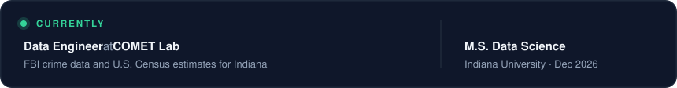
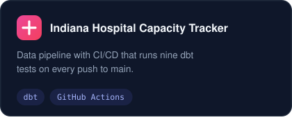
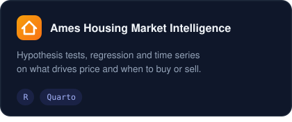
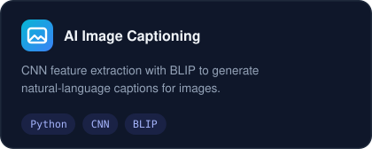
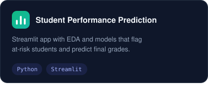

 

**I build data pipelines and backend systems, and I like making messy data trustworthy.**

M.S. Data Science · Indiana University &nbsp;|&nbsp; M.S. Computer Science · Purdue University

 

&nbsp;&nbsp;

 
 

 
 

### Popular repositories

<!-- REPOS:START -->
&nbsp;
 
&nbsp;
<!-- REPOS:END -->

 

### Tools

 
 

